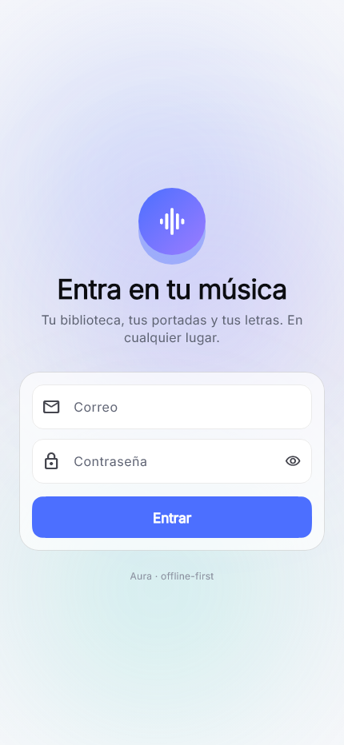

# Aura

**Your own music app: a private library, HD artwork, synchronized lyrics and an
offline-first player that feels native.**

Aura is a personal music system built as three cooperating pieces: a FastAPI
service in the cloud, a Python worker on a home PC, and a Flutter app for
Android, iOS and Windows. It is designed for one user (with a multi-user schema),
so it stays simple, private, and cheap to run.


---

## Why Aura

Most music apps own your library. Aura is the opposite: your files live in your
own Cloudflare R2 buckets, your metadata lives in your own Neon database, and
downloads run on your own machine. The app is a client, not a store.

- **Private by construction.** Buckets are private; every media URL is a
  short-lived signed URL. The API never proxies audio and keeps no files.
- **Cheap to operate.** The API is stateless, the database can scale to zero,
  and the idle worker uses a 30-second long poll instead of a SQL polling loop.
- **Offline-first.** The library, playlists, lyrics, queue and play events live
  in SQLite. Tracks you download play from disk with no network at all.
- **Native feel.** One accent color, iOS-like surfaces, reduced-motion support,
  palette-aware artwork and a player that never blocks on the server.

## Features

| Area | What is implemented |
| --- | --- |
| **Library** | Songs, albums and artists synced with cursor pagination into Drift; instant local search; favorites |
| **Ingestion** | `POST /v1/ingest` queues a job; the worker resolves, downloads, probes, analyzes, enriches, tags and uploads |
| **Artwork** | Candidate scoring, WebP covers, dominant palette, thumbhash placeholder, signed URLs |
| **Lyrics** | LRCLIB lookup, LRC parsing (multi-timestamp, offset, word timings), embedded lyrics in M4A, synchronized lyrics screen |
| **Player** | Queue engine, shuffle/repeat, ReplayGain volume, speed, sleep timer, background-ready `just_audio`, persistent position |
| **Offline** | Drift cache, lyrics cache, persistent queue, idempotent play outbox, on-device audio downloads with progress and cancellation |
| **Stats** | `GET /v1/stats/overview`, Wrapped data and achievements API; in-app statistics screen with 7/30/90-day and all-time ranges |
| **Operations** | Alembic migrations, health/readiness split, RFC 9457 errors, request IDs, rate limits, optional Sentry, CI |

## Screenshot

The login baseline is checked by a golden test on Windows:



## Architecture

```
┌──────────────────────────────┐        ┌──────────────────────────────┐
│ Flutter app                  │        │ Cloudflare R2                │
│ Android · iOS · Windows      │◄──────►│ audio · art · waveforms      │
│ Riverpod · Drift · just_audio│ signed │ private buckets, signed URLs │
└──────────────┬───────────────┘  URLs  └──────────────▲───────────────┘
               │ HTTPS + JWT                          │ upload (S3 API)
               ▼                                      │
┌──────────────────────────────┐        ┌──────────────┴───────────────┐
│ FastAPI (Render)             │        │ Worker (home PC)             │
│ auth · library · queue · API │◄──────►│ yt-dlp · ffmpeg · mutagen    │
│ no persistent disk           │  SQL   │ MusicBrainz · LRCLIB         │
└──────────────┬───────────────┘        └──────────────────────────────┘
               │
               ▼
┌──────────────────────────────┐
│ Neon Postgres                │
│ metadata · jobs · stats      │
└──────────────────────────────┘
```

The worker owns every download and every upload. The API only stores metadata
and issues signed URLs. Read
[`docs/ARCHITECTURE.md`](docs/ARCHITECTURE.md) for request flows and
[`docs/DECISIONS/`](docs/DECISIONS/) for the reasoning behind each boundary.

## Project status

| Phase | Scope | Status |
| --- | --- | --- |
| 0 | Monorepo, tooling, docs | Done |
| 1 | FastAPI base, health, deployment config | Done |
| 2 | PostgreSQL schema, models, Alembic | Done |
| 3 | Auth, library API, Dart client | Done |
| 4 | Job queue, worker, yt-dlp, R2 | Done |
| 5 | Covers and metadata enrichment | Done |
| 6 | Lyrics and synchronization | Done |
| 7 | Flutter design system | Done |
| 8 | Player and queue | Done |
| 9 | Synced-lyrics experience | Done |
| 10 | Stats, achievements and Wrapped | API + in-app stats screen done; Home/Inbox feeds not built |
| 11 | Home-screen widgets | Not implemented |
| 12 | Offline downloads and resilience | Partial: audio downloads (2 concurrent, progress, cancel, remove, "download favorites"), metadata/lyrics cache and play outbox; no resume-after-kill, SHA-256 verification, LRU cleanup or dedicated Downloads screen |
| 13 | Quality, security, CI, release | Done in code; live integrations still need credentials |
| 14 | AI features | Not implemented (configuration placeholders only) |

> Aura is honest about what has not been exercised: the code and tests exist,
> but no Neon, R2, YouTube, MusicBrainz or LRCLIB credentials are bundled, so a
> live end-to-end run has not been recorded in this repository.

## Quick start

### Prerequisites

- Python 3.13 and [uv](https://docs.astral.sh/uv/)
- Flutter 3.10+ (Dart 3.10)
- PostgreSQL 17 (Docker is the easiest path)
- `ffmpeg`, `deno` and `yt-dlp` for the worker
- Cloudflare R2 credentials for real uploads

### 1. Backend

```bash
git clone https://github.com/JnthnUribe/AURA_appmusic.git
cd AURA_appmusic

cp .env.example .env          # fill DATABASE_URL, JWT_SECRET and R2_*
cd backend
uv sync --dev
uv run alembic upgrade head
uv run aura create-user --email you@example.com --password 'a-long-password'
uv run fastapi dev src/aura/main.py
```

Local Postgres without installing it:

```bash
docker compose -f infra/docker-compose.yml up -d postgres
```

Health checks:

- `GET /healthz` — liveness, **never** touches the database
- `GET /readyz` — readiness, checks the database
- `GET /v1/version` — build metadata

### 2. Worker (home PC)

```bash
cd backend
uv run python -m aura.worker
```

The worker claims jobs with `SELECT ... FOR UPDATE SKIP LOCKED`, updates
progress, and long-polls `/v1/internal/worker/wait` when idle. It opens no
inbound ports.

Windows install helper:

```powershell
powershell -ExecutionPolicy Bypass -File scripts\install_worker_windows.ps1 -StartNow
```

### 3. Flutter app

```bash
cd app
flutter pub get
dart run build_runner build --force-jit   # only after Drift/l10n changes
flutter run --dart-define-from-file=env/dev.json
```

`env/dev.json` points at `http://localhost:8000`; `env/prod.json` points at the
Render deployment. The app uses Spanish copy and an offline-first Drift cache.

## Configuration

Copy [`.env.example`](.env.example) and fill the values. Never commit `.env`.

| Variable | Purpose |
| --- | --- |
| `APP_ENV` | `dev`, `test` or `prod` (production rejects weak secrets) |
| `APP_BASE_URL` | Public API URL |
| `CORS_ORIGINS` | JSON list of allowed origins |
| `DATABASE_URL` | Pooled PostgreSQL URL used by the API |
| `DIRECT_DATABASE_URL` | Direct URL used by Alembic and the worker |
| `JWT_SECRET` | ≥32 random bytes |
| `WORKER_TOKEN` | ≥24 random bytes; authenticates the worker |
| `R2_ACCOUNT_ID`, `R2_ACCESS_KEY_ID`, `R2_SECRET_ACCESS_KEY` | R2 credentials |
| `R2_BUCKET_AUDIO`, `R2_BUCKET_ART` | Private buckets |
| `SENTRY_DSN` | Optional error reporting |
| `AURA_TEST_DATABASE_URL` | Enables PostgreSQL integration tests |

## API

The generated contract lives in [`docs/openapi.json`](docs/openapi.json)
(43 paths). Regenerate it after any router change:

```bash
cd backend
uv run aura export-openapi --output ../docs/openapi.json
```

Highlights: `/v1/auth/*`, `/v1/tracks`, `/v1/albums`, `/v1/artists`,
`/v1/search`, `/v1/playlists`, `/v1/favorites`, `/v1/ingest`, `/v1/jobs`,
`/v1/plays/batch`, `/v1/stats/overview`, `/v1/stats/wrapped`,
`/v1/achievements`.

## Testing

```bash
cd backend
uv run pytest
uv run ruff check . && uv run ruff format --check .
uv run pyright

cd ../app
flutter analyze
flutter test
```

Current local results:

- Backend: **44 passed, 6 skipped** (the skipped tests need a PostgreSQL URL)
- Ruff: clean, 55 files formatted
- Pyright: **0 errors**
- App: **41 tests passed**, `flutter analyze` clean
- Golden test is generated on Windows and skipped on other hosts to avoid
  font-rasterization differences

CI runs the backend against PostgreSQL 17 and the Flutter analyzer/tests on
every push to `main` (`.github/workflows/`).

## Repository layout

| Path | Contents |
| --- | --- |
| `backend/src/aura/api` | FastAPI app, routers, dependencies, error handling |
| `backend/src/aura/core` | Settings, security, normalization, cursors, LRC |
| `backend/src/aura/db` | SQLAlchemy 2 models, async sessions |
| `backend/src/aura/providers` | Interchangeable audio/metadata/lyrics sources |
| `backend/src/aura/services` | Auth, library, storage, jobs, audio analysis |
| `backend/src/aura/worker` | Long-poll loop and ingestion pipeline |
| `backend/alembic` | Versioned migrations |
| `app/lib` | Flutter client (Riverpod, Drift, go_router, just_audio) |
| `app/test` | Unit, widget, Drift and golden tests |
| `docs` | Architecture, data model, design, ADRs, OpenAPI |
| `infra` | Local PostgreSQL Docker Compose |
| `scripts` | Seed demo data, OpenAPI export, worker installers |
| `.claude/skills` | Project-specific agent skills |

## Documentation

- [Architecture](docs/ARCHITECTURE.md) — components, flows, deployment topology
- [Data model](docs/DATA_MODEL.md) — tables, indexes, invariants
- [Design system](docs/DESIGN.md) — tokens, screens, motion, accessibility
- [Status](docs/STATUS.md) — what is done, partial and missing
- [Runbook](docs/RUNBOOK.md) — deploy, migrate, back up, roll back
- [ADRs](docs/DECISIONS/) — seven architecture decision records
- [OpenAPI](docs/openapi.json) — generated API contract
- [Agent guide](AGENTS.md) and [project memory](CLAUDE.md) — for coding agents

## Deployment

| Piece | Host | Notes |
| --- | --- | --- |
| API | Render web service (`render.yaml`) | Docker image, `/healthz` probe |
| Database | Neon Postgres | Pooled URL for the API, direct URL for migrations |
| Objects | Cloudflare R2 | Private buckets, signed URLs |
| Worker | Home PC | Outbound only; systemd or Windows Task Scheduler |
| App | Stores / sideload | Android, iOS, Windows |

Rules enforced by code and docs: no persistent files on the API, no Render free
Postgres, no secrets in git, and no periodic SQL polling.

## Known limitations

- Live integrations were not exercised without credentials. Provider tests use
  deterministic fakes; there is no recorded end-to-end demo.
- Background audio and lock-screen controls depend on platform configuration and
  were not validated on physical devices here.
- Windows playback needs `libmpv-2.dll` beside the executable.
- Audio downloads do not yet resume after the process is killed, verify SHA-256,
  or enforce the "Wi-Fi only" preference; the preference is stored for a future
  connectivity integration.
- Phase 11 home-screen widgets and phase 14 AI features are out of scope.
- The app is single-user in practice; the schema is multi-user so it can grow.

## Legal

This is a private, personal project. Downloading audio from YouTube violates its
Terms of Service and may infringe copyright; lyrics are copyrighted too. Keep
the app private, never expose a bucket, and prefer the interchangeable
`SourceProvider` interface with files you own (CDs, purchases, Bandcamp,
Creative Commons).
